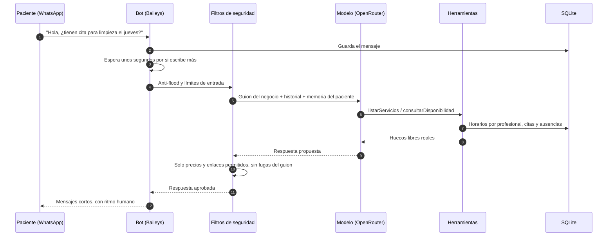
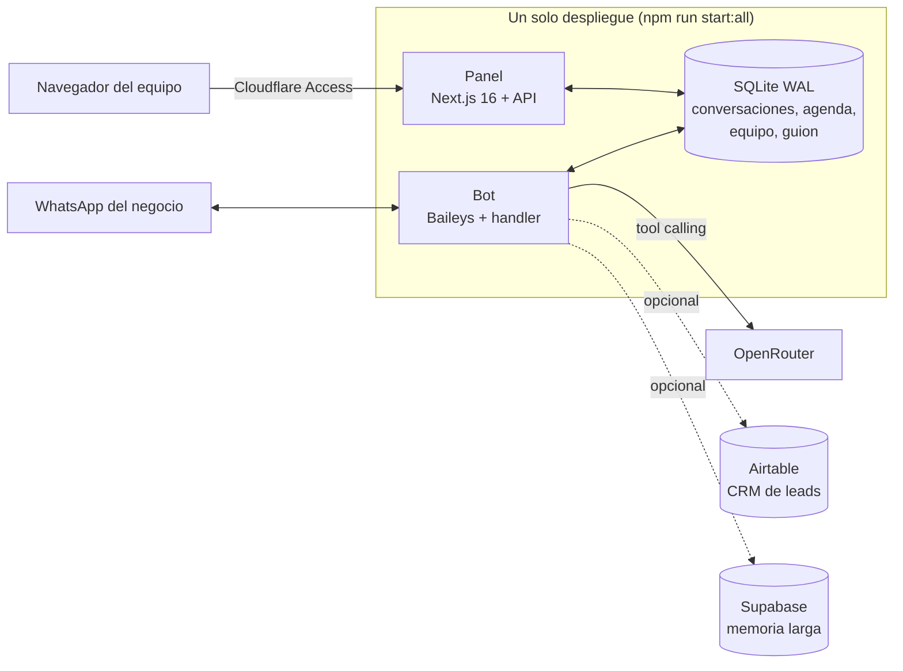

<p align="center">
  
</p>

# Agente de WhatsApp · Clínica Bienestar

Atiende el WhatsApp de una clínica odontológica de principio a fin: responde dudas, da precios oficiales, agenda, reprograma y cancela citas con el profesional correcto, y avisa a un asesor solo cuando hace falta.

> [!NOTE]
> **Este es un repositorio de presentación.** Aquí está la documentación del proyecto: qué hace, cómo está construido, cómo se probó y qué aprendí. El código fuente vive en un repositorio privado. Si quieres revisarlo para una entrevista o una colaboración, escríbeme por [LinkedIn](https://www.linkedin.com/in/diego-eduardo-chourio-garcia-472291385/) y te doy acceso.


Un solo proyecto con dos piezas:

- **Bot**: escucha el WhatsApp del negocio, agrupa los mensajes de cada persona, entiende notas de voz e imágenes y responde con el guion de la clínica, usando herramientas para consultar la agenda real.
- **Panel**: dashboard web para ver las conversaciones en vivo, tomar el control de un chat, gestionar la agenda, el equipo, los servicios y el guion del negocio, y revisar métricas.

La clínica de este repositorio (Clínica Bienestar, Medellín) es un caso de demostración: dirección, teléfono y profesionales son datos de ejemplo.

## Qué hay en este repositorio

| Archivo | Contenido |
|---|---|
| `README.md` | Resumen, flujo de un mensaje, arquitectura, decisiones de diseño y lecciones |
| [`docs/arquitectura.md`](docs/arquitectura.md) | Cada pieza del sistema y cómo se conectan |
| [`docs/pruebas-de-seguridad.md`](docs/pruebas-de-seguridad.md) | Las 16 categorías de ataque y casos de ejemplo |

## El panel

| Sección | Para qué |
|---|---|
| **Conversaciones** | Chats en vivo; se puede pausar el bot en uno y responder a mano |
| **Agenda** | Vista semanal de las citas, filtrable por profesional |
| **Equipo** | Profesionales, horarios semanales, ausencias y servicios que da cada uno |
| **Negocio** | Guion del agente por bloques, con historial de versiones y prueba en vivo |
| **Métricas** | Conversaciones, mensajes, leads, citas agendadas, tiempo medio de respuesta y embudo (escribieron → dejaron email → recibieron el enlace) |
| **Ajustes** | Pausa general del bot, segundos de espera para agrupar mensajes y transcripción de notas de voz |

## Cómo funciona un mensaje



## Arquitectura

Recorrido completo de un mensaje y detalle de cada pieza en [docs/arquitectura.md](docs/arquitectura.md).



## Herramientas del agente

| Herramienta | Qué hace |
|---|---|
| `listarServicios` | Servicios, precios y qué profesional atiende cada uno |
| `consultarDisponibilidad` | Huecos libres reales de un profesional, según su horario y ausencias |
| `agendarCita` | Reserva la cita en la agenda propia (sin servicios externos) |
| `listarMisCitas` | Citas próximas del paciente que escribe |
| `reprogramarCita` / `cancelarCita` | Cambia o cancela una cita existente |
| `calificar` | Puntúa el interés del paciente para decidir cuándo proponer la cita |
| `guardarLead` | Registra nombre, email y necesidad; lo envía al CRM cuando está completo |
| `escalarAAsesor` | Pasa la conversación a una persona del equipo y la avisa |

## Decisiones de diseño

- **La agenda es propia.** Cada profesional tiene su horario y sus ausencias en SQLite; el agente no puede ofrecer un hueco que no exista ni agendar con quien no hace ese servicio.
- **Filtros de salida.** Toda respuesta pasa por guardrails: solo precios de una lista permitida, solo enlaces de dominios autorizados y un canario que detecta si el modelo intenta revelar sus instrucciones.
- **Agrupación de mensajes.** Espera `BUFFER_SECONDS` antes de responder, para contestar a una ráfaga de mensajes como lo haría una persona.
- **Control manual.** Desde el panel se puede pausar el bot en una conversación y responder a mano; el bot no interfiere mientras esté en modo humano.
- **Guion editable con historial.** El guion del negocio se edita por bloques desde el panel, con versiones y opción de restaurar.
- **Autovigilancia.** Un watchdog revisa que el bot siga respondiendo y avisa por WhatsApp a un número de alertas si se queda mudo.
- **Conexión estable con Baileys.** Versión de protocolo descargada al arrancar, huella de navegador conocida y reconexión con esperas distintas según el código de error.
- **Validar en el código, no solo en el prompt.** Las herramientas de agenda comprueban que el profesional dé el servicio pedido y que se haya consultado esa disponibilidad antes de reservar.

## Pruebas de seguridad (red team)

El agente se prueba con **119 conversaciones de ataque** en 16 categorías: regateo y descuentos, horarios y profesionales inventados, inyección de instrucciones, autoridad falsa, límites médicos, urgencias, privacidad, entre otras. Cada conversación corre contra el pipeline real (prompt y herramientas incluidos), con el CRM desactivado para no ensuciarlo, y un juez automático compara cada respuesta con los datos oficiales de la clínica.

Categorías y ejemplos de casos en [docs/pruebas-de-seguridad.md](docs/pruebas-de-seguridad.md).

## Stack

| Capa | Tecnologías |
|---|---|
| Panel | Next.js 16, React 19, Tailwind CSS 4 |
| Bot | Node.js 22, `@whiskeysockets/baileys`, `tsx` |
| Modelos | OpenRouter (SDK de `openai`) con tool calling, transcripción de audio y lectura de imágenes |
| Datos | SQLite con WAL (`better-sqlite3`); Airtable y Supabase opcionales |
| Despliegue | Nixpacks + EasyPanel en VPS, protegido con Cloudflare Access |

## Estructura del código

Organización del repositorio privado:

```
.
├── src/
│   ├── app/                 Panel y API (conversaciones, agenda, equipo, servicios, negocio, métricas)
│   ├── components/          Interfaz del panel
│   └── lib/
│       ├── baileys/         Conexión a WhatsApp, manejo de mensajes y cola de salida
│       ├── tools/           Herramientas del agente
│       ├── openrouter.ts    Llamada al modelo con tool calling
│       ├── system-prompt.ts Arma el prompt desde prompts/negocio.md
│       ├── guardrails.ts    Filtros de entrada y salida
│       ├── scheduling.ts    Motor de disponibilidad y citas
│       └── watchdog.ts      Autovigilancia con avisos
├── prompts/negocio.md       Guion de la clínica
├── redteam/                 Pruebas de ataque y juez
├── scripts/                 Asistente de instalación, diagnóstico, arranque del bot
└── docs/                    Guías: arquitectura, instalación, WhatsApp, despliegue, errores comunes
```

## Lo que aprendí

- **Una reserva con `ok: true` no es una reserva correcta.** El modelo a veces cruzaba los IDs y agendaba una valoración de ortodoncia cuando la paciente había pedido una limpieza, y además se lo confirmaba con total seguridad. Reforzar el prompt bajaba la frecuencia pero no la eliminaba. Lo que lo cortó fue validarlo en el código: `consultarDisponibilidad` y `agendarCita` rechazan un profesional que no da ese servicio, y la reserva exige que esa conversación haya consultado antes esa misma disponibilidad (queda registrado en SQLite).
- **El modelo no sabe qué día es.** Sin la fecha inyectada en cada llamada, "el próximo lunes" daba tres fechas distintas en tres corridas idénticas. Ahora el prompt lleva la fecha y la hora reales en la zona del negocio.
- **Con tool calling, el texto puede venir en el mismo turno que la herramienta.** Al descartarlo, cada paciente recibía el mensaje de emergencia en vez de la respuesta.
- **Un debounce puro no tiene techo.** Alguien que escribía ocho mensajes seguidos nunca recibía respuesta, porque cada mensaje reiniciaba la espera. Se añadió un tope de 30 s contado desde el primer mensaje.
- **El límite de turnos también puede ser un bug.** Con 5 vueltas, buscar disponibilidad día por día se cortaba y el paciente se quedaba con un "vuelvo contigo enseguida". Se subió a 8.
- **Una agenda propia hereda todo lo que hace un calendario.** El bot ofrecía citas el 1 de enero. Ahora el motor calcula los festivos colombianos de cada año (Ley Emiliani y Semana Santa a partir de la fecha de Pascua).
- **WhatsApp Web cambia sin avisar.** Los chats nuevos llegan con direcciones `@lid` en vez del número, el código 405 aparece si la versión del protocolo está vieja, el 440 entra en bucle si se reconecta muy rápido tras vincular y el 515 no es un error, sino parte del emparejamiento.
- **Nada de I/O al importar un módulo en Next.js.** Abrir la base de datos en el cuerpo del módulo hacía fallar `next build` con `SQLITE_BUSY`; ahora se abre en la primera llamada.
- **La prueba más importante es el camino feliz.** Un fallo al agendar una limpieza normal pesa más que diez fallos en ataques raros, porque es lo que vive cada paciente.

## Limitaciones

- Usa WhatsApp Web (Baileys), no la API oficial de Meta. Sirve para responder a quien escribe al negocio; para envíos masivos hay que usar la API oficial.
- Una instancia por número de WhatsApp.
- El panel no tiene login propio: en producción se protege con Cloudflare Access.

## Autor

**Diego Chourio Garcia** · Estudiante de Ingeniería de Sistemas, Universidad EAFIT · [LinkedIn](https://www.linkedin.com/in/diego-eduardo-chourio-garcia-472291385/)

¿Quieres ver el código? Pídeme acceso al repositorio privado por LinkedIn.
